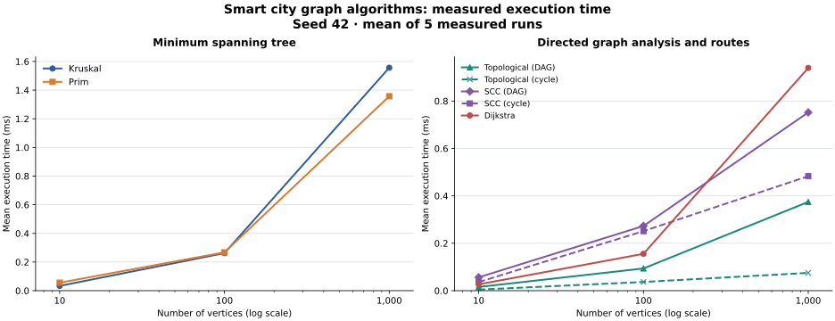
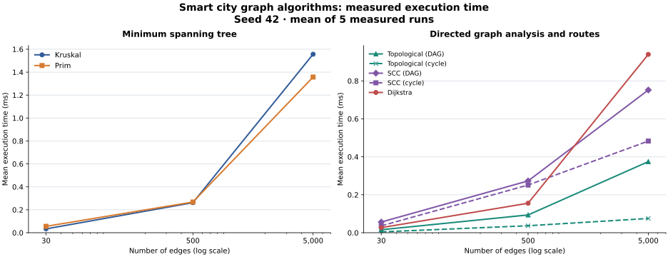

# Assignment 3: Smart City Infrastructure and Route Planning

## Project overview

This Java project represents city districts as vertices and roads or service dependencies as weighted edges. The graph uses adjacency lists. Undirected roads are available in both directions, while directed connections have one outgoing arc. Parallel edges and self-loops are preserved. Each logical edge appears once in the edge list.

The project implements a disjoint-set union (DSU), Kruskal's and Prim's minimum spanning tree algorithms, topological ordering, strongly connected components (SCC), and Dijkstra's shortest paths. The MST algorithms return selected roads, total construction cost, and connectivity. The directed-graph algorithms analyze one-way roads and service dependencies. The repository includes reproducible experiments, result tables, and plots for the three graph sizes required by the assignment.

## How to run

Use Java 17 or newer. Run these commands from the `assignment3` folder:

```powershell
$classes = "target/classes"
New-Item -ItemType Directory -Force $classes | Out-Null
$sources = Get-ChildItem src/main/java -Filter *.java -Recurse | ForEach-Object FullName
javac -encoding UTF-8 -d $classes $sources
java -cp $classes daa.assignment3.Main --test
java -cp $classes daa.assignment3.Main --demo
java -cp $classes daa.assignment3.Main --benchmark results/results.csv
```

The test command prints `PASS: 25903 checks`. The demonstration runs both MST algorithms, shows topological ordering and SCCs, and prints shortest distances and routes from district 0, including an unreachable district. The benchmark command regenerates the raw CSV and `results/tables/summary.md`.

To regenerate the plots from the saved CSV, use Python 3.10 or newer:

```powershell
python -m pip install -r requirements-plot.txt
python scripts/plot_results.py
```

## Implementation

`WeightedGraph` stores each input edge once and keeps an adjacency list for every vertex. Its edge and neighbor views are read-only. Weights use `long`, and the graph accepts negative weights because minimum spanning tree algorithms can use them. Dijkstra rejects a graph containing any negative edge.

`DisjointSetUnion` starts with one component per vertex. `find` compresses paths, and `union` attaches the smaller component to the larger one. A repeated union returns `false`; a successful union reduces the component count.

`Kruskal` sorts logical edges by weight and joins their endpoints only when the DSU says they belong to different components. `Prim` grows each component from its lowest-numbered unvisited vertex using a priority queue of candidate roads. Both ignore self-loops and work with parallel edges, duplicate weights, and negative construction costs. On a disconnected graph they return a minimum spanning forest with `connected=false` and the number of components. Summing selected weights uses checked `long` arithmetic.

Each result also records operation counts: examined edges or adjacency arcs, ordering comparisons, priority-queue offers and polls, and DSU find calls, parent traversals, and union calls. The benchmark reports these counters alongside execution time.

`TopologicalSort` uses Kahn's algorithm: it repeatedly removes a vertex with zero in-degree. If fewer than `V` vertices can be removed, the graph has a cycle and the result contains no order. `Kosaraju` finds SCCs with an iterative depth-first search, a reversed adjacency list, and a second iterative search in decreasing finish order. Both algorithms require a directed graph. Their metrics count vertex visits and examined arcs; topological ordering counts each edge during in-degree construction and processing, while SCC counts it during both searches and reversal.

`Dijkstra` starts from a selected district and uses a binary priority queue to process the next smallest tentative distance. A better route updates that district's distance and predecessor; stale queue entries are skipped. The result provides an optional distance and a vertex-by-vertex path for each district. An unreachable district has no distance and an empty path. A separate reachability flag allows `Long.MAX_VALUE` to be a valid distance. Distance addition throws on `long` overflow instead of silently wrapping. Metrics count examined arcs, successful relaxations, queue offers and polls, and ordering comparisons.

Dijkstra's greedy choice relies on non-negative weights: with a negative road, a route processed later could reduce a distance already treated as final. The implementation checks all logical edges before starting and rejects negative weights.

## Complexity analysis

For `V` vertices and `E` logical edges, the graph uses `O(V + E)` space and adds an edge in `O(1)` amortized time. DSU initialization and storage each cost `O(V)`. With path compression and union by size, `find` and `union` each have amortized `O(α(V))` time, where `α` is the inverse Ackermann function. A single `find` can still take `O(log V)` before compression; `union` performs two finds and a constant amount of other work.

Kruskal sorts `E` edges in `O(E log E)` time and performs at most `E` DSU unions in `O(E α(V))` total time. Its extra space is `O(V + E)` for the sorted edge list, DSU, and result. Prim uses adjacency lists and a binary priority queue. Its lazy queue can hold `O(E)` candidate edges, so time is `O(V + E log E)` and extra space is `O(V + E)`. For a simple graph, `E = O(V²)`, making the logarithmic factor `O(log V)`. The reported edge counts differ: Kruskal examines logical edges, while Prim examines adjacency arcs, normally twice per undirected road.

Kahn's topological ordering takes `O(V + E)` time and `O(V)` extra space for in-degrees, its queue, and the output order. Kosaraju's SCC algorithm takes `O(V + E)` time and `O(V + E)` extra space for the reversed adjacency list, visited arrays, search stacks, and components. These bounds assume adjacency lists; both searches visit each vertex and edge a constant number of times.

Dijkstra first checks all `E` edges for non-negative weights. With adjacency lists and a lazy binary heap, it then takes `O(V + E log E)` time and `O(V + E)` extra space in the worst case. Each successful relaxation adds one queue entry; a previously queued entry may become stale. For a simple graph, this is commonly written `O((V + E) log V)`. The algorithm scans only vertices reachable from the chosen source after the initial weight check.

## Experimental setup

The three configurations are small (`V=10, E=30`), medium (`V=100, E=500`), and large (`V=1,000, E=5,000`). Every generator uses fixed seed `42`, unique edges, and integer weights from 1 to 1,000. The undirected graph begins with a random spanning tree and adds random roads until it has exactly `E` edges, so MST inputs are connected. The directed DAG begins with the chain `0 -> 1 -> ... -> V-1` and adds only forward edges. The cyclic directed graph keeps that chain, adds forward edges, and finishes with `V-1 -> 0`; it has exactly `E` edges and one SCC. Dijkstra runs from vertex 0 on the cyclic directed graph. Graph generation is excluded from timing.

Each of the seven algorithm/graph combinations receives three unmeasured warm-up runs and five measured runs at each size. `System.nanoTime()` surrounds only the algorithm call; the arithmetic mean of five elapsed times is reported. The benchmark checks that outputs and operation counts agree across repetitions. Timings vary with the JVM, operating system, and hardware. The directed cycle is deliberate: Kahn's algorithm can detect it after the in-degree scan without dequeuing any vertex.

## Results

The [raw CSV](results/results.csv) contains all 21 combinations, mean nanoseconds, operation counts, and result summaries. The [tables](results/tables/summary.md) compare Kruskal with Prim, DAGs with cyclic graphs, and Dijkstra across the three sizes. Kruskal and Prim return the same MST weight for every size. SCC examines each directed edge during both searches and when building the reverse graph. Dijkstra examines the 5,000 arcs of the large cyclic graph from source 0.





The plots use the CSV means in milliseconds. Their horizontal axes use a logarithmic scale so all three required sizes remain visible. Both `V` and `E` increase between configurations; the two plots show the same runs from different horizontal axes and do not isolate the effect of one variable.

## Comparison and discussion

For the largest undirected graph, both algorithms found weight `113553`. Kruskal averaged `1.5564 ms`, and Prim averaged `1.3573 ms` in the saved run. Kruskal examined 3,337 sorted edges before completing the tree, but its sort made 55,151 ordering comparisons. Prim examined 10,000 adjacency arcs and made 111,794 heap comparisons. Different counter definitions and memory access patterns mean a lower edge count does not guarantee a lower elapsed time. Prim was faster on this large run, while Kruskal was faster on the small run; five timings per size do not establish a general winner.

Kruskal made 6,674 DSU finds and 6,069 parent traversals on the large graph. Path compression shortens later searches, while union by size limits tree height before compression. This supports the near-constant amortized cost predicted by `α(V)`; sorting still determines Kruskal's asymptotic bound.

SCC's edge examinations rose from 90 to 15,000 as the directed graphs grew, exactly three scans per edge. The DAG run grew from `0.0564 ms` to `0.7520 ms`; the cyclic run grew from `0.0363 ms` to `0.4830 ms`. Both trends are consistent with linear `O(V + E)` work, although elapsed-time ratios need not match operation-count ratios because tiny runs include fixed JVM and allocation costs. The DAG has `V` singleton SCCs, while the chain and back edge make the cyclic graph one SCC.

Topological ordering visited every vertex in each DAG. In each generated cyclic graph, every vertex has positive in-degree, so Kahn's queue starts empty: it reports a cycle after the initial `E`-edge scan and visits zero vertices. This explains why the cyclic rows are faster without changing the algorithm's `O(V + E)` worst-case bound.

Dijkstra's examined arcs grew from 30 to 5,000, and successful relaxations from 11 to 1,145. Mean time rose from `0.0268 ms` to `0.9397 ms`; heap ordering comparisons also increased from 38 to 13,393. The observed growth fits a scan plus priority-queue work. The measured graphs use non-negative weights, as required for Dijkstra.

These are five-run means on one generated graph per size. JVM warm-up, garbage collection, CPU load, and short measurement intervals affect individual times. Three sizes are enough for the requested comparison, but not for estimating a precise empirical growth exponent. The operation counts give a more stable check against the theoretical bounds.

## Testing

The correctness suite checks directed and undirected adjacency, parallel edges, self-loops, a single-vertex graph, invalid vertex indices, read-only edge access, and DSU behavior. MST cases cover connected and disconnected graphs, multiple valid MSTs, duplicate and negative weights, a single vertex, rejection of directed graphs, and total-weight overflow. On 100 reproducible connected graphs, the suite compares Kruskal's and Prim's weights and verifies that each result is acyclic and spans every input component.

Directed-graph tests check valid orders on DAGs, rejection of cycles and self-loops, and the SCC partition of a graph with three components. They also cover 50 reproducible DAGs with added back edges. For 60 other small directed graphs, SCC membership is checked against independently computed mutual reachability. Every vertex must belong to exactly one SCC.

Shortest-path tests cover known distances and routes, directed and undirected graphs, cycles and zero weights, a single vertex, unreachable vertices, negative-edge rejection, invalid source and target indices, `Long.MAX_VALUE`, and overflow. On 100 reproducible small graphs, distances from every source are compared with an independent Bellman-Ford implementation. Each reported path is checked against actual graph edges and its reported distances.

Generator tests check edge counts, repeatability with the same seed, undirected connectivity, DAG ordering, the planned cycle and SCC count, source reachability, and invalid configurations. The benchmark also validates its graphs and compares both MST weights before timing.

## Conclusion

Use Kruskal or Prim to choose a minimum-cost set of roads connecting districts; this implementation reports a minimum spanning forest when the network is disconnected. Kruskal works directly from the edge list and DSU, while Prim grows from adjacency lists and a priority queue. Use topological ordering to schedule acyclic service dependencies and SCCs to identify groups connected by directed routes in both directions. Use Dijkstra for distances and routes when road weights are non-negative. The tests establish correctness for the covered cases, and the measured counts broadly agree with each algorithm's complexity.

## AI acknowledgement

AI assisted with the code, documentation, experiment setup, and plot presentation. The numeric values in the CSV, tables, and plots came from the Java benchmark; they were not invented by AI.
